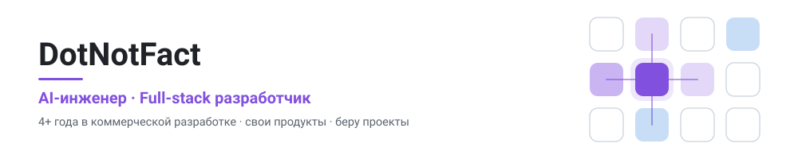

  <picture>
    <source media="(prefers-color-scheme: dark)" srcset="assets/header-dark.svg">
    <source media="(prefers-color-scheme: light)" srcset="assets/header-light.svg">
    
  </picture>

  
  

> [!NOTE]
> **Беру проекты.** Удалённо: заказная разработка, проектная работа, ИИ в вашем продукте.
> Цену и срок называю до начала работы.

---

## Чем могу помочь

Беру задачу целиком и довожу до результата, которым пользуются каждый день.

| Задача | Что получите |
|---|---|
| **ИИ в бизнесе** | Ассистент по вашим документам, который отвечает с цитатой и честно пишет «не нашёл»; ИИ-агенты с подтверждением человеком; извлечение данных и сводки |
| **Продукт под ключ** | Интерфейс, сервер, база, интеграции и запуск. Код, доступы и инструкция у вас |
| **Боты и автоматизация** | Telegram-боты с заявками и оплатой, парсеры, интеграции через API, сценарии на n8n |
| **Настольные программы** | Приложения для Windows, которые работают без интернета: учёт, утилиты, рабочие места |
| **Доработка и спасение** | Найти, почему падает, починить, закрыть тестом и объяснить простыми словами |

**4+ года коммерческой разработки.** Системы для корпоративных заказчиков и ПО для
электроэнергетики, где через систему шли данные с тысяч подстанций и ошибка стоила дорого.
50+ заказов на фрилансе. ИИ-проекты для коммерческих клиентов под NDA.

---

## Проекты

### Istok. Фабрика сенсорных стендов 🔒

Раньше каждый стенд в зале был отдельной программой под конкретную выставку. Здесь
сотрудник собирает стенд в браузере: экраны, кнопки, фото, видео, PDF. На выходе
Windows-приложение или пакет для киоска, работает без интернета.

`ASP.NET Core` · модульный монолит на 10 модулей · `PostgreSQL` · `Redis` · `MinIO` · `Next.js` · `Tauri v2 / Rust` · `Docker Compose`

→ [о проекте](https://dotnotfact.github.io/istok-about/)

### Lead Radar. Сборщик заказов с ИИ-оценкой 🔒

Настольное приложение: собирает заказы с бирж и Telegram, отсеивает лишнее правилами,
оценивает ИИ, готовит отклик, ведёт переписки и сделки, присылает свежее в Telegram.
Ничего не отправляет само: решение остаётся за человеком.

`Tauri v2` · `Rust` · `React` · `TypeScript` · `SQLite` · сквозные тесты на Playwright

### Пульт. Команды проекта одной кнопкой

Программа для Windows: находит скрипты проекта, объясняет простыми словами, что делает
каждая команда и меняет ли она файлы, запускает и ведёт историю. Рядом git, CI и подсказки.

`Tauri v2` · `Rust` · `TypeScript` → [pult](https://github.com/DotNotFact/pult)

### Сайт

Сайт-визитка на Next.js: предложение, кейсы, решения с ценой.

`Next.js` · `TypeScript` → [dotnotfact.github.io/dotnotfact-site](https://dotnotfact.github.io/dotnotfact-site/) · [код](https://github.com/DotNotFact/dotnotfact-site)

### Ещё

| Репозиторий | О чём | Стек |
|---|---|---|
| [dotpilot](https://github.com/DotNotFact/dotpilot) | Портативный центр управления ПК: сеть, звук, профили, разгон видеокарты через NVAPI с автоматическим откатом | Tauri v2, Rust, TypeScript |

> 🔒 Приватные. Архитектуру и подход показываю на созвоне: от схемы модулей до конкретных ADR.

---

## Как я работаю

- **Цена и срок до начала.** Письменно фиксирую, что вы получите и к какому дню.
- **Результат по ходу.** Показываю промежуточные версии, а не всё в последний день.
- **Проверка до сдачи.** Тесты на важное, на ИИ проверка качества на ваших вопросах.
- **Всё у вас.** Исходный код, доступы, инструкция. Ошибки по заданию исправляю бесплатно 14 дней.

---

## Как я принимаю решения

У каждого пункта есть четвёртый абзац: чем я за это заплатил. У любого решения есть
цена, и про неё лучше говорить сразу.

<b>Одно ядро плеера вместо восьми версий продукта</b>

 

**Кому было больно.** Сотрудник музея не мог поменять фотографию на стенде без программиста. Под каждый зал приложение писали заново, неделями.

**Почему нельзя просто.** У меня самого накопилось восемь версий такой программы, и все упирались в одно: то, что видит редактор, и то, что показывает стойка, это разный код. Держать два кода одинаковыми через ревью и тесты не выходит. Они расходятся быстрее, чем это успевают заметить.

**Что сделал.** Одно ядро плеера: `packages/runtime`, чистый TypeScript без привязки к окружению. Вокруг него три сменные оболочки: браузер, Windows-приложение, киоск. Они говорят с ядром через интерфейс `ShellAdapter`, за которым спрятано всё, что зависит от платформы. Ядро никогда не спрашивает, какая вокруг него оболочка, только «умеешь ли ты полный экран». Превью в редакторе это буквально тот же плеер, который поедет в зал.

**Чем заплатил.** Ядро нельзя писать на удобном фреймворке, только на голом TypeScript, иначе оболочки перестают быть сменными. Писать так медленнее и скучнее. И каждую новую фичу надо сразу продумывать для всех трёх оболочек.

<b>Отказ от MediatR</b>

 

**Кому было больно.** Мне. Поддерживать это буду я один.

**Почему нельзя просто.** Обычно для CQRS в .NET берут MediatR. Мне нужны были ровно четыре интерфейса: команда, запрос и два обработчика. Ради этого библиотека приносит рефлексию в рантайме и прячет, кто именно обработает вызов.

**Что сделал.** Написал четыре интерфейса сам, решение записал в ADR 0003. В рантайме никакой рефлексии, эндпоинт получает нужный обработчик напрямую через DI, а F12 ведёт в конкретный класс, а не в диспетчер.

**Чем заплатил.** Логирование, валидацию и транзакции пришлось навешивать декораторами руками. И новому человеку в проекте надо один раз объяснить, почему здесь сделано не как у всех.

<b>Правило, которое я сам отменил вместе с его тестом</b>

 

**Кому было больно.** Сотруднику музея, который качает готовый стенд на плохом интернете.

**Почему нельзя просто.** У меня было правило «одна ссылка, одно скачивание», ради безопасности, и оно было закреплено тестом. Потом настоящий стенд после растеризации PDF оказался **3,17 ГБ**. Обрыв на девяноста процентах означал начинать заново. Защита превратилась в «человек не может забрать свой файл».

**Что сделал.** Удалил правило вместе с тестом. Теперь ссылка живёт заданный срок и умеет докачивать с места обрыва.

**Чем заплатил.** Ссылку внутри этого срока действительно можно переслать. Я обменял это на то, что файл вообще доходит.

<b>PDF растеризуется на сервере, а стойка листает картинки</b>

 

**Кому было больно.** Владельцу, у которого на стенде вместо документа был пустой экран.

**Почему нельзя просто.** PDF показывали встроенным просмотрщиком движка. На его машине WebView2 или выключен политикой, или не открывает документ. Обе причины вне моего контроля, починить их у заказчика я не могу.

**Что сделал.** Убрал эту зависимость совсем. Документ заранее разбирается на страницы на сервере, в изолированном воркере: без сети, только чтение, seccomp, лимиты. В стенд едут готовые картинки, посетитель листает их пальцем.

**Чем заплатил.** Сборка стала тяжелее и дольше, и именно из-за растеризации стенд вырос до трёх гигабайт. Текст в таком PDF больше нельзя выделить и найти поиском.

---

## Стек

Инструмент подбираю под задачу, а не задачу под инструмент.

- **Фронтенд и full-stack**: React, Next.js, TypeScript
- **Бэкенд**: C#, ASP.NET Core, EF Core, PostgreSQL, Redis; Python для данных и ИИ
- **Настольное и системное**: Rust, Tauri v2
- **ИИ**: RAG с цитатами, ИИ-агенты, проверка качества ответов, российские модели при необходимости
- **Инфраструктура**: Docker, CI/CD, модульный монолит, ADR как рабочий инструмент

---

## Чего у меня нет

Пишу сам, до вопроса, чтобы никто не тратил время:
**Kafka, Kubernetes в проде, высокие нагрузки, шардирование.**
С этим не работал и писать, что работал, не буду.

---

**[Telegram @dotnotfact](https://t.me/dotnotfact)** · **[Сайт](https://dotnotfact.github.io/dotnotfact-site/)**

Опишите задачу: отвечу, берусь ли, и назову цену до начала работы.

